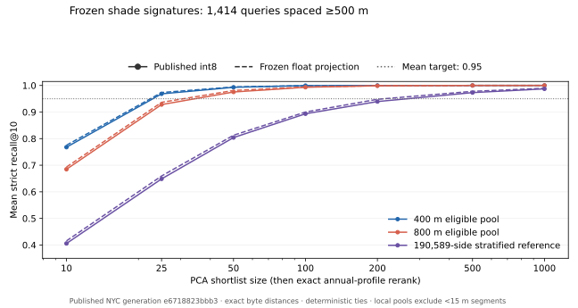

# A3 offline benchmark: local retrieval passes; transport and tails need work

**Decision:** a PCA shortlist of 100 followed by exact annual-profile reranking meets the **mean
recall@10 ≥ 0.95** gate for radius-filtered 400 m and 800 m searches. Cold annual-profile reads
remain expensive, and rare queries fail badly despite the average. Resolve both before shipping
`likeCandidateId`; follow-up [#347](https://github.com/marcopolocheung/umbra/issues/347).

The experiment reuses Phase 0's table loader, sampling and fidelity analysis from
`~/umbra-phase0/signatures.py`/`maps.py`, the committed frozen-model projection/byte conventions,
scikit-learn's brute Euclidean distances, and the actual client `SignatureView` and `ShadeTableView`.
No model was fitted, no published data changed, and no app feature was added.



## Inputs and protocol

- Published generation: **`nyc-2026-09-18-e6718823bbb3`**, signatures-v1, 386 cells,
  **1,608,171 segments / 3,216,342 sidewalk sides**, 581 frozen daylight slots.
- **1,414 query sides from 383 cells**, seed `20261012`, at most four per cell, globally separated
  by at least **500 m**. Queries use segments at least 15 m long. These are retrieval queries over
  the published dataset's support, not a borough holdout or an estimate of segment-weighted demand.
- Local candidate pools: load cells intersecting the existing radius bounding box, then filter
  by segment length ≥15 m and midpoint haversine distance ≤400/800 m **before shortlisting**.
  Both sidewalk sides remain independent. UI block-face deduplication is not applied.
- Local pools must contain the reference and ten other qualifying sides. **1,405** cases remain
  at 400 m and **1,412** at 800 m. At 400 m, five queries selected no shards, one reference was
  not loaded, and three had fewer than ten neighbours; at 800 m, two selected no shards.
  Geometry bounds are clipped to owner cells, so long-edge midpoints can be beyond the selection.
  These cases are reported as exclusions, not perfect retrieval scores.
- Global diagnostic: a cell-stratified nominal 200k sample plus all queries, **190,589 sides** after
  sparse-cell limits and deduplication. **This is not brute force against all 3.2M city sides.**
  Unlike the local product pool, this reference retains short segments, following Phase 0.
- Compare published int8 codes dequantized into float32, exactly as the client does, with the
  frozen unquantized projection as a diagnostic. All **51,461,472** published component codes
  match projection and quantization from the frozen model; there was no refit or decoder mismatch.
- Ground truth is L2 on the same 581 **model-generated table values**. Float64 integer-byte
  distances avoid float32 cancellation; centring and division by 255 do not change neighbour order.
- Exclude the query by identity, rather than dropping the first zero-distance result. Resolve
  distance ties by stable global row order (cell, shade-index segment, side). Report strict
  identity recall, tie-aware cutoff quality, the Phase 0 1.1× distance measure and zero-distance misses.
  Confidence intervals resample **cells**, 1,000 bootstrap draws.

## Fidelity results

Each entry is mean strict recall@10 after reranking the published int8 shortlist by exact distance.
M=10 retains the ten PCA candidates and only changes their ordering.

| Shortlist M | 400 m, 1,405 queries | 800 m, 1,412 queries | Global sample, 1,414 queries |
|---:|---:|---:|---:|
| 10 | 0.7678 | 0.6848 | 0.4057 |
| 25 | 0.9685 | 0.9281 | 0.6487 |
| 50 | 0.9931 | 0.9754 | 0.8040 |
| **100** | **0.9994** | **0.9932** | **0.8935** |
| 200 | 0.9999 | 0.9987 | 0.9395 |
| 500 | 1.0000 | 1.0000 | 0.9731 |
| 1,000 | 1.0000 | 1.0000 | 0.9872 |

M=100 cell-bootstrap 95% intervals are **[0.99855, 0.99993]** at 400 m,
**[0.98964, 0.99609]** at 800 m, and **[0.88031, 0.90529]** on the global sample.
Tie-aware values are 0.9994 / 0.9936 / 0.8942 respectively; literal ties explain little of the
remaining average gap. The global sample's 1.1×-distance success is 0.9726 at M=100.

The frozen float projection yields M=100 recall 0.9994 / 0.9943 / 0.9000. Higher precision alone
barely changes the aggregate result. The global sample needs approximately M=500 to pass the mean
0.95 gate; that does not establish a suitable M for full-city search. The historical Phase 0 0.41
is contextual evidence, not a paired before/after score on this new query/reference population.

### The average hides important tails

At M=100, **5/1,405** 400 m queries and **36/1,412** 800 m queries have recall below 0.95.
The worst 400 m recall is 0.5; the worst 800 m recall is **0.0**, with returned neighbours' mean
exact distance **3.07×** the true ten's. Both cases are in the client parity probes.

| 800 m query row / cell | Int8 M=100 | Float M=100 | Int8 M=200 | Int8 M=500 | Distance ratio at int8 M=100 |
|---|---:|---:|---:|---:|---:|
| 3052693 / z14-4837-6151 | 0.0 | 1.0 | 1.0 | 1.0 | 3.068 |
| 1765981 / z14-4829-6147 | 0.1 | 0.1 | 0.9 | 1.0 | 1.010 |
| 3034420 / z14-4836-6164 | 0.2 | 0.3 | 0.7 | 1.0 | 1.193 |

The first is a quantization failure; the latter examples also lose neighbours under the float
projection. A shortlist cannot recover neighbours it omitted. M=500 recovers every measured local
top ten, but often includes the whole smaller candidate pool. A fixed M=100 should therefore have
a tested expansion/fallback policy before being described as consistently accurate.

## Actual client parity and resident CPU

The Node probe follows the existing benchmark/test pattern and calls the production
`createSignatureView().nearest()` and `createShadeTableView().shadowFor()`. Radius-filtered signature
rows are copied into a temporary view; full owner-cell shade indexes retain their original row order.
**43 queries / 4,258 shortlisted neighbours**, including the three worst 800 m cases, agree with
Python on exact shortlist identities/order and all exact squared profile distances.

Node **v24.21.0**, WSL/Linux on an Intel Core i7-12700H (20 logical CPUs), resident data, ten timed repetitions after a warm-up per query:

| M | PCA shortlist median / p95 | Exact rerank median / p95 |
|---:|---:|---:|
| 100 | 0.070 / 0.119 ms | 5.282 / 9.213 ms |
| 200 | 0.140 / 0.223 ms | 10.564 / 15.767 ms |
| 500 | 0.414 / 0.582 ms | 26.298 / 36.191 ms |

Building both views costs median 4.968 ms / p95 14.519 ms. File preparation is measured separately
and mixes cold and cached local files; it is not an HTTP loading benchmark. The rerank prototype
reads every daylight slot through the existing view and checks each lookup; it is not optimized.
These figures do not establish phone/browser or end-to-end assistant latency.

## Annual-profile delivery is the practical gate

After restricting annual reads to **cells owning the shortlist plus its reference**, M=100 still
requires these current slot-major payloads:

| Scope | Median annual bytes | p95 annual bytes | Median range requests |
|---|---:|---:|---:|
| 400 m | **8.25 MB** | **23.85 MB** | **24** |
| 800 m | **14.02 MB** | **32.93 MB** | **36** |
| Global sample | 381.80 MB | 517.25 MB | 780 |

MB is decimal. These are **uncompressed object/range byte counts**, not measured wire traffic.
Each cell needs twelve contiguous daylight runs; every run includes every segment's two sides,
regardless of how few candidates need reranking. The ideal candidate-only byte count for 100 sides
plus a reference is **58,681 bytes**, but the current API does not deliver that layout.

Fetching annual slots for every selected local cell would cost median **8.82 / 16.89 MB** at
400/800 m. Street JSON separately costs median **2.52 / 4.82 MB**, signatures **0.258 / 0.494 MB**,
and shade indexes **0.189 / 0.360 MB**; existing caches can help repeat queries. No additional model
or approximate index is needed to address the profile-read overfetch.

## Next step and reproduction

A3's retrieval method has a measured local path forward. Before integrating it:

1. Decide how to bound candidate-profile delivery using existing storage/delivery capabilities.
   An owner-approved new artifact or a selective-read adapter needs its own concrete design.
2. Choose and test a tail policy: larger shortlists or expansion to exact local search. A mean
   0.95 target is not a per-query guarantee.
3. Keep the radius/length filter ahead of PCA search. Evaluate block-face-aware output and
   cross-area references separately; the current experiment centres each radius on its reference.

The scripts and aggregated [measurements](shade-signature-rerank-2026-10-12.json) are committed.
The 2.4 GiB decoded cache, query details and raw per-query records stay at
`~/umbra-signature-benchmark/nyc-2026-09-18-e6718823bbb3/`. Phase 0 artifacts are preserved.

From `server/navigation-prep`, using the existing miniconda environment:

```bash
NAVIGATION_PREP_ROOT="$HOME/shade-prep-data-nyc-navigation" \
  "$HOME/miniconda3/bin/python" tools/benchmark_signature_rerank.py \
  nyc-2026-09-18-e6718823bbb3 --output "$HOME/umbra-signature-benchmark"

# Add --reuse-cache for subsequent runs. Add --plot <path.svg> for the figure.
PATH="$HOME/.local/node24/bin:$PATH" node_modules/.bin/tsx \
  tools/benchmark_signature_client.ts \
  "$HOME/shade-prep-data-nyc-navigation/normalized/nyc-2026-09-18-e6718823bbb3/navigation/nyc/nyc-2026-09-18-e6718823bbb3" \
  "$HOME/umbra-signature-benchmark/nyc-2026-09-18-e6718823bbb3"

"$HOME/miniconda3/bin/python" -m unittest discover -s tools \
  -p test_benchmark_signature_rerank.py
```

Versions: Python 3.12.8, NumPy 2.2.3, SciPy 1.16.2, scikit-learn 1.9.0; four library threads.
Optional chart export uses the existing Matplotlib 3.10.0 installation.
The cached Python pass takes approximately 95–110 seconds with peak RSS 3.49 GiB. First decoding reads
and checks all referenced shade/street/signature inputs; a cache reuse checks manifest/index
fingerprints and array shapes. Exact-zero misses are counted separately from distance ratios so
undefined ratios cannot hide errors.

Input fingerprints: manifest `65f8670d74148b96855338a12c914b89fc38f5ea2d6f1e00c1c20208eb437b68`,
signature index `bd62abbda4f61b676ffadd85aaf2fb196b5a4b9b01581c38fd13b11befaf446a`.

An independent repeat reproduced all curves, byte estimates, query counts and input fingerprints.
Verification also passed seven hermetic metric checks, client parity above, repository lint/typecheck,
2,809 app tests and production build. Benchmark scripts are separate from the app test runner.
